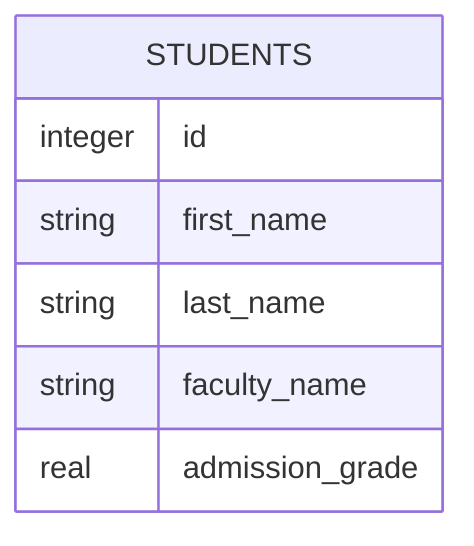
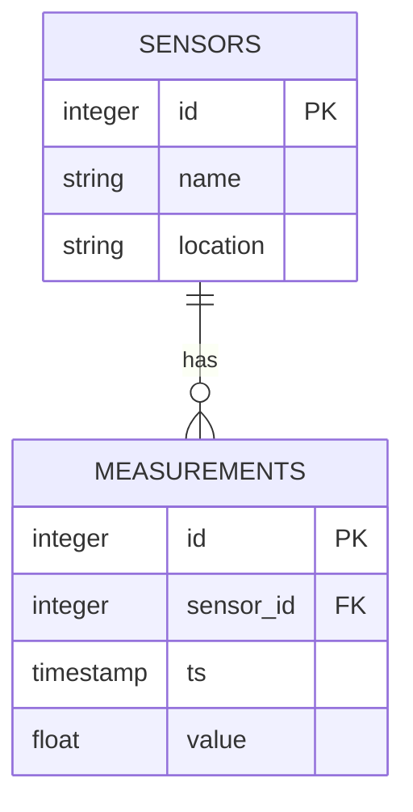

# Laboratorul 2

!!! abstract "Obiective"

    Să ne familiarizăm cu limbajul SQL și cu principalele tipuri de comenzi. Să învățăm despre modelul relațional al datelor și despre cum putem proiecta o schemă de bază de date, respectiv cum o putem reprezenta grafic.

!!! warning

    Vom presupune că ați instalat și configurat deja sistemul de baze de date [PostgreSQL](https://www.postgresql.org/) și că vă puteți conecta la el pentru a rula comenzi. Dacă nu aveți setup-ul funcțional, consultați [instrucțiunile din laboratorul 1](laboratorul-1) sau cereți ajutor de la tutorele de laborator.

## Modelul relațional

Cum am menționat și în laboratorul precedent, în prima parte a cursului vom lucra cu baze de date **relaționale**. Acestea se potrivesc foarte bine pentru stocarea datelor structurate, tabelare. În comparație cu utilizarea unei simplu fișier (CSV, TSV, Excel etc.) din care citim și în care scriem explicit, majoritatea sistemelor de baze de date relaționale funcționează **declarativ**: noi trebuie doar să proiectăm baza de date, iar apoi putem începe să o populăm și să o folosim; este responsabilitatea SGBD-ului să determine cum să stocheze datele cât mai eficient pe disk și cum să răspundă cât mai rapid la solicitări (însă nu strică să-i oferim informații adiționale, pentru o mai bună eficiență).

În modelul relațional, toate datele sunt reprezentate sub formă de [_relații matematice_](https://en.wikipedia.org/wiki/Relation_(mathematics)). Nu vom intra în detaliu în teoria din spatele acestora, dar este suficient să înțelegem că în practică o bază de date relațională stochează o serie de **tupluri**:
$$
    \left(1, \text{Ion}, \text{Cutărescu}, \text{Facultatea de Fizică}, 9.5\right)
$$
Fiecare tuplu este un **rând** dintr-un **tabel** (numit și _relație_). Fiecare tabel are o **denumire** _unică_ (cel puțin, la nivel de bază de date sau schemă). Coloanele tabelului sunt identificate prin **nume** și sunt asociate cu un **tip de date**. Toate rândurile din tabel trebuie să aibă aceeași structură; pot avea valori diferite în fiecare coloană, dar cu respectarea tipului de date și a constrângerilor asociate.

Pentru rândul dat ca exemplu mai sus, un tabel care să îl conțină ar putea fi:

- Denumire tabel/relație: „studenți”
- Coloane:
    - ID unic: număr întreg
    - Prenume: text de lungime variabilă
    - Nume: text de lungime variabilă
    - Facultate: text de lungime variabilă
    - Medie admitere: număr real, precizie de 4 zecimale

În principiu, este bine să începem proiectarea unei baze de date prin identificarea obiectelor care trebuie stocate și a proprietăților de interes ale acestora. După aceea, începem să le implementăm într-un sistem de gestiune a bazelor de date (e.g. PostgreSQL) folosind comenzi de SQL (pe care le vom discuta în acest laborator).

### Tipuri de date

Există o multitudine de tipuri fundamentale de date pe care le putem folosi în proiectarea bazei noastre de date (șiruri de caractere, șiruri/date binare, numere întregi, numere reale cu reprezentare în virgulă mobilă, numere zecimale momente de timp și date, intervale de timp, etc).

Câteva tipuri de date pe care le veți folosi destul de des:

- `int` sau `integer`: numere întregi (pe 4 bytes)

- `real`: număr real, reprezentare cu virgulă mobilă (pe 4 bytes)

- `text`: șir de caractere (de lungime variabilă)

- `time`: moment de timp (pe parcursul unei zile)

- `timestamp`: dată și timp

Lista completă cu tipurile de date cunoscute de PostgreSQL poate fi găsită [aici](https://www.postgresql.org/docs/current/datatype.html). Totodată, vom vedea mai târziu că se pot crea și tipuri de date noi („compuse”), deși această abordare vine cu avantaje și dezavantaje.

## Diagrame ER

Cel mai natural mod de a reprezenta vizual tabelele dintr-o bază de date relațională și legăturile dintre ele este folosind o **diagramă entitate-relație** (_Entity-Relationship Diagram_ sau mai pe scurt _ER diagram_). Reprezentăm tabelele ca dreptunghiuri cu liste de coloane (și tipurile de date asociate), legate între ele prin săgeți (care simbolizează referințele / constrângerile dintre tabele).

De exemplu, tabelul cu studenți descris anterior poate fi reprezentat printr-o diagramă foarte simplă:



În schimb, tabelul cu senzori și măsurători, folosit ca exemplu la sfârșitul primului laborator, ar avea următoare diagramă ER:



## Introducere în SQL

**Limbajul de interogare structurat** (_Structured Query Language_ - SQL) a fost introdus în anii '70, iar începând cu anii '80 a ajuns destul de repede să fie metoda preferată pentru a interacționa cu bazele de date. Începând cu 1986, a fost inclusiv standardizat de [ANSI](https://en.wikipedia.org/wiki/American_National_Standards_Institute) și ulterior și de [ISO](https://en.wikipedia.org/wiki/International_Organization_for_Standardization).

Limbajul SQL este un [limbaj de programare _declarativ_](https://en.wikipedia.org/wiki/Declarative_programming). În comparație cu limbajele imperative/procedurale cu care v-ați obișnuit (e.g. C/C++/Python), un limbaj declarativ se concentrează pe rezultatele pe care dorim să le obținem, nu pe modul în care calculăm/determinăm acele valori.

De menționat că limbajul SQL este _case-insensitive_; toate comenziile pot fi scrise `cu litere mici` sau `CU LITERE MARI` sau `CU o combiNAȚiE ArBiTrARĂ` de litere mici și mari.

## Categorii de comenzi

Toate comenziile din SQL (varianta standard, de bază, ignorând extensiile) pot fi împărțite în 5 categorii:

- **Data Definition Language** (DDL): comenzi folosite pentru a defini tabelele și relațiile dintre ele, pentru a le modifica structura sau pentru a le șterge cu totul sau reseta la starea inițială (tabel gol). Le vom folosi în principal la începutul activității noastre, când proiectăm și implementăm prima versiune a bazei de date, iar apoi doar ocazional pentru mentenanță sau actualizări ale schemei.

- **Data Manipulation Language** (DML): comenzi folosite pentru a introduce noi înregistrări (rânduri) în tabelele din baza de date și pentru a actualiza/modifica sau șterge înregistrările create anterior.

- **Data Query Language** (DQL): comenzi folosite pentru a interoga și extrage informații din datele existente; se reduce la comanda `SELECT` și la toate cuvintele cheie asociate cu aceasta.

- **Transaction Control Language** (TCL): comenzi pentru a gestiona sistemul de _tranzacții_, care permit utilizarea concurentă a bazei de date într-un mod sigur. Vom discuta despre tranzacții în detaliu într-un laborator viitor.

- **Data Control Language** (DCL): comenzi folosite pentru a acorda sau revoca accesul unor utilizatori la anumite tabele sau comenzi din baza de date. Foarte utile într-un mediu de lucru de producție, în care putem avea mai multe conturi care se conectează la același BD.

## Crearea unei baze de date

O să parcurgem pas cu pas toate etapele necesare creării unei baze de date, pentru a înțelege codul din fișierul [`measurements.sql`](data/measurements.sql) pe care l-am folosit data trecută.

Când am instalat PostgreSQL, respectiv când am creat container-ul, a fost creată/inițializată automat și o _bază de dată_ (denumită `postgres`, la fel ca numele utilizatorului implicit) iar noi am lucrat în aceasta. În realitate, un singur server de PostgreSQL poate gestiona zeci sau sute de baze de date distincte, fiecare cu propriile scheme (tabele, legături, date) etc. Pentru această parte a laboratorului, vom crea o bază de date distinctă:

```sql
CREATE DATABASE exercitiu;
```

Pentru a selecta baza de date nou-creată și pentru a putea rula comenzi în ea, putem folosi metacomanda `\connect`:

```sql
\connect exercitiu
```

Dacă folosiți o interfață grafică cum ar fi pgAdmin sau DataGrip, s-ar putea să fie nevoie în schimb să comutați la noua bază de date prin intermediul interfeței.

Având în vedere relația dintre tabelel noastre, vom începe prin a crea tabelul pentru stocarea listei de senzori:

```sql
CREATE TABLE sensors (
    id INTEGER PRIMARY KEY,
    name TEXT NOT NULL,
    location TEXT NOT NULL
);
```

După aceea, vom crea laboratorul de măsurători:

```sql
CREATE TABLE measurements (
    id INTEGER PRIMARY KEY,
    sensor_id INT NOT NULL REFERENCES sensors(id) ON DELETE RESTRICT,
    timestamp TIMESTAMP DEFAULT CURRENT_TIMESTAMP,
    value FLOAT NOT NULL
);
```

## Exerciții

1. Încercați să rezolvați [exercițiile din categoria _Basic exercises_](https://pgexercises.com/questions/basic/) de pe site-ul [PostgreSQL Exercises](https://pgexercises.com/).
