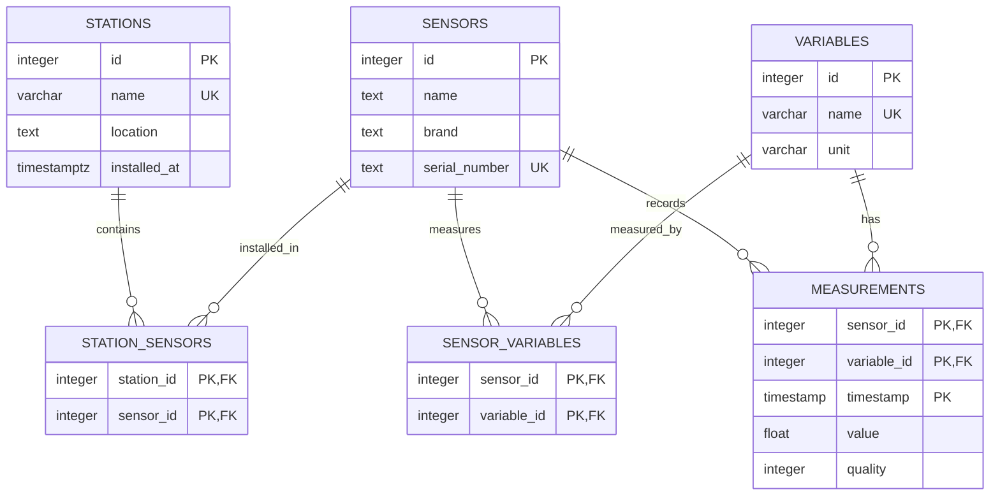
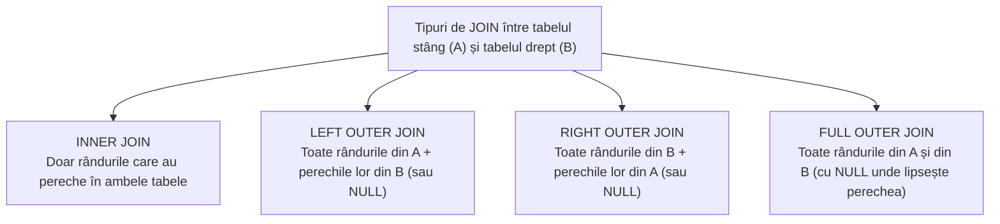

# Laboratorul 4

!!! abstract "Obiective"

    Să învățăm cum putem îmbina datele din mai multe tabele diferite folosind comanda `JOIN`. Să înțelegem care sunt principalele tipuri de `JOIN`-uri (_inner join_, _left/right outer join_, _full outer join_) în analogie cu noțiunea de produs cartezian. Să vedem cum putem reuni sau intersecta diferite seturi de rezultate și cum putem pagina rezultatele folosind `LIMIT` și `OFFSET`.

## Utilizarea mai multor tabele în aceeași interogare

Pe lângă interogarea tabelelor în mod individual, adevărata putere a limbajului SQL este că permite combinarea înregistrărilor din mai multe tabele pentru a extrage informații. De exemplu, putem găsi toți roboții care au în componență senzori produși de o anumită firmă, putem ordona studenții după media anuală la o anumită materie, putem obține o listă cu drone etc.

Pentru a face acest lucru, putem folosi [sub-interogări](https://www.postgresql.org/docs/current/functions-subquery.html) (_subqueries_), cum am făcut și în laboratorul precedent, sau putem face [îmbinări](https://www.postgresql.org/docs/current/functions-subquery.html) (_joins_). În spate, optimizatorul de query-uri SQL va alege cea mai eficientă variantă de calculare a rezultatului.

### Structura bazei de date și relațiile _many-to-many_

În acest laborator vom folosi o bază de date care modelează o rețea de stații de monitorizare a mediului, [`environmental_stations.sql`](data/environmental_stations.sql). Creați o bază de date nouă (de exemplu, `lab4`) și încărcați în ea structura și datele din fișier.

Dacă analizați tabelele din [`environmental_stations.sql`](data/environmental_stations.sql), veți observa că schema este împărțită în șase tabele:

- `stations`: stațiile de cercetare (nume, adresă, data instalării);
- `sensors`: senzorii fizici (denumire, producător/brand, serie unică);
- `variables`: mărimile fizice măsurate (temperatură, presiune, viteza vântului etc.) și unitățile lor de măsură;
- `station_sensors`: tabel de legătură care indică în ce stație este instalat fiecare senzor;
- `sensor_variables`: tabel de legătură care indică ce variabile poate măsura fiecare senzor (de exemplu, un senzor meteo integrat poate măsura atât temperatura, cât și presiunea și umiditatea);
- `measurements`: măsurătorile propriu-zise, identificate prin senzor, variabilă și momentul de timp (`timestamp`).

Diagrama de mai jos oferă o perspectivă vizuală asupra schemei bazei de date:



Observați două elemente noi în definițiile tabelelor (`CREATE TABLE`):

1. **Chei primare compuse** (_composite primary keys_): Un tabel poate avea o singură cheie primară, dar aceasta poate fi formată din **mai multe coloane**. De exemplu, în `sensor_variables`, același `sensor_id` poate apărea de mai multe ori (dacă măsoară mai multe variabile), și același `variable_id` poate apărea de mai multe ori (fiind măsurat de senzori diferiți), dar perechea `(sensor_id, variable_id)` trebuie să fie unică:

    ```sql
    CREATE TABLE sensor_variables (
        sensor_id INTEGER REFERENCES sensors(id) ON DELETE CASCADE,
        variable_id INTEGER REFERENCES variables(id) ON DELETE CASCADE,
        PRIMARY KEY (sensor_id, variable_id)
    );
    ```

2. **Tabele asociative (de joncțiune)**: Relațiile de tip _many-to-many_ (un senzor poate măsura mai multe variabile, iar o variabilă poate fi măsurată de mai mulți senzori) se modelează în bazele de date relaționale printr-un tabel intermediar (`sensor_variables`) care conține chei străine către cele două tabele pe care le conectează.

### Produsul cartezian (`CROSS JOIN`)

Din punct de vedere matematic, operația de bază prin care combinăm două relații (tabele) $A$ și $B$ este **produsul cartezian** $A \times B$: fiecare rând din primul tabel este asociat cu fiecare rând din al doilea tabel. Dacă tabelul $A$ are $m$ rânduri și tabelul $B$ are $n$ rânduri, produsul cartezian va conține $m \times n$ rânduri.

În SQL, produsul cartezian poate fi obținut folosind `CROSS JOIN` (sau enumerând tabelele cu virgulă în clauza `FROM`):

```sql
SELECT
  st.name AS station_name,
  v.name AS variable_name,
  v.unit AS variable_unit
FROM stations AS st
CROSS JOIN variables AS v;
-- echivalent cu FROM stations AS st, variables as v
```

Deoarece avem $6$ stații și $6$ variabile, această interogare va returna $6 \times 6 = 36$ de rânduri, generând toate combinațiile posibile (util, de exemplu, dacă vrem să generăm un tabel gol cu toate combinațiile stație&ndash;variabilă).

În majoritatea cazurilor însă, nu ne interesează toate perechile posibile, ci doar acele perechi de rânduri care au legătură între ele (de exemplu, acele perechi în care cheia străină dintr-un tabel este egală cu cheia primară din celălalt tabel).

## Tipurile de `JOIN`

O clauză [`JOIN`](https://www.postgresql.org/docs/current/tutorial-join.html) poate fi privită drept un produs cartezian urmat de o filtrare pe baza unei condiții de asociere specificate după cuvântul-cheie `ON`. În funcție de cum sunt tratate rândurile care **nu** au niciun corespondent în celălalt tabel, avem patru tipuri principale de `JOIN`.



### Inner join

Comanda `INNER JOIN` (sau, mai simplu, `JOIN` — cuvântul `INNER` este opțional) păstrează în rezultat **doar _perechile_ de rânduri care satisfac condiția din `ON`**. Dacă un rând din primul tabel nu are niciun corespondent în al doilea tabel (sau invers), acesta este omis din rezultat.

De exemplu, pentru a afișa fiecare măsurătoare împreună cu denumirea variabilei și unitatea de măsură corespunzătoare:

```sql
SELECT
    m.timestamp,
    m.sensor_id,
    v.name AS variable_name,
    m.value,
    v.unit
FROM measurements AS m
INNER JOIN variables AS v ON m.variable_id = v.id
ORDER BY m.timestamp, m.sensor_id;
```

Putem înlănțui mai multe clauze `JOIN` în aceeași interogare pentru a traversa tabelele de legătură. De exemplu, pentru a vedea ce senzori sunt instalați în fiecare stație, unim `stations` cu `station_sensors`, iar apoi cu `sensors`:

```sql
SELECT
    st.name AS station_name,
    s.name AS sensor_name,
    s.brand,
    s.serial_number
FROM stations AS st
INNER JOIN station_sensors AS ss ON st.id = ss.station_id
INNER JOIN sensors AS s ON ss.sensor_id = s.id
ORDER BY st.name, s.serial_number;
```

Observați că în rezultatul de mai sus nu apar stațiile `Brăila` și `Sibiu` (deoarece nu au niciun senzor asociat în `station_sensors`), și nici senzorul cu seria `HUM-01` (deoarece nu este instalat în nicio stație).

!!! tip "Scurtătura `USING`"

    Atunci când coloana după care facem joncțiunea are **exact același nume** în ambele tabele (de exemplu, `sensor_id` în `station_sensors` și în `sensor_variables`), putem scrie `JOIN ... USING (sensor_id)` în loc de `JOIN ... ON t1.sensor_id = t2.sensor_id`.

### Left-outer join

`LEFT OUTER JOIN` (sau mai scurt `LEFT JOIN`) returnează **toate rândurile din tabelul din stânga** (cel menționat înainte de `LEFT JOIN`), împreună cu rândurile corespondente din tabelul din dreapta. Dacă pentru un rând din stânga nu există niciun rând în dreapta care să satisfacă condiția `ON`, coloanele provenite din tabelul din dreapta vor fi completate cu `NULL`.

De exemplu, dacă vrem o listă cu **toate stațiile**, inclusiv cele în care nu a fost montat încă niciun senzor:

```sql
SELECT
    st.name AS station_name,
    st.location,
    s.name AS sensor_name,
    s.serial_number
FROM stations AS st
LEFT JOIN station_sensors AS ss ON st.id = ss.station_id
LEFT JOIN sensors AS s ON ss.sensor_id = s.id
ORDER BY st.name, s.serial_number;
```

Pentru `Brăila` și `Sibiu`, coloanele `sensor_name` și `serial_number` vor avea valoarea `NULL`.

Această proprietate este foarte des folosită pentru a găsi rândurile din primul tabel care **nu au corespondent** în al doilea tabel (așa-numitul _anti-join_):

```sql
-- Stațiile care nu au niciun senzor instalat:
SELECT st.id, st.name, st.location
FROM stations AS st
LEFT JOIN station_sensors AS ss ON st.id = ss.station_id
WHERE ss.sensor_id IS NULL;
```

### Right-outer join

`RIGHT OUTER JOIN` (sau `RIGHT JOIN`) este simetricul lui `LEFT JOIN`: păstrează **toate rândurile din tabelul din dreapta**, completând cu `NULL` coloanele din tabelul din stânga atunci când nu există o potrivire.

De exemplu, dacă pornim de la `station_sensors` și facem `RIGHT JOIN` cu `sensors`, vom obține toți senzorii, inclusiv pe cei care nu sunt instalați în nicio stație (precum senzorul de umiditate `HUM-01`):

```sql
SELECT
    st.name AS station_name,
    s.id AS sensor_id,
    s.name AS sensor_name,
    s.serial_number
FROM stations AS st
INNER JOIN station_sensors AS ss ON st.id = ss.station_id
RIGHT JOIN sensors AS s ON ss.sensor_id = s.id
ORDER BY s.id;
```

În practică, orice `RIGHT JOIN` poate fi rescris ca un `LEFT JOIN` inversând ordinea tabelelor (`A RIGHT JOIN B` este echivalent cu `B LEFT JOIN A`). Mulți dezvoltatori preferă `LEFT JOIN` pentru consistență și lizibilitate, însă `RIGHT JOIN` este util atunci când avem deja un lanț de `JOIN`-uri și vrem să păstrăm toate rândurile din ultimul tabel adăugat.

### Full outer join

`FULL OUTER JOIN` (sau `FULL JOIN`) combină efectul unui `LEFT JOIN` cu cel al unui `RIGHT JOIN`: păstrează **toate rândurile din ambele tabele**. Acolo unde un rând din stânga nu are pereche în dreapta, coloanele din dreapta vor fi `NULL`, iar acolo unde un rând din dreapta nu are pereche în stânga, coloanele din stânga vor fi `NULL`.

De exemplu, pentru a obține o vedere de ansamblu care să includă atât stațiile fără senzori, cât și senzorii nealocați vreunei stații:

```sql
SELECT
    st.name AS station_name,
    s.name AS sensor_name,
    s.serial_number
FROM stations AS st
FULL OUTER JOIN station_sensors AS ss ON st.id = ss.station_id
FULL OUTER JOIN sensors AS s ON ss.sensor_id = s.id
ORDER BY st.name NULLS LAST, s.serial_number;
```

Dacă vrem să afișăm **doar** anomaliile sau elementele neasociate din ambele părți (stații fără senzori și senzori fără stație), putem adăuga `WHERE st.id IS NULL OR s.id IS NULL`.

## Operații pe mulțimi de rezultate

În timp ce `JOIN` combină tabelele „pe orizontală” (adăugând coloane din mai multe tabele pe același rând), operațiile pe mulțimi combină rezultatele a două sau mai multe interogări `SELECT` „pe verticală” (adăugând sau filtrând rânduri).

Pentru a putea aplica o operație pe mulțimi între două interogări `SELECT`:

1. Ambele interogări trebuie să returneze **același număr de coloane**;
2. Coloanele corespondente (pe aceleași poziții) trebuie să aibă **tipuri de date compatibile**.

Principalele operații pe mulțimi în SQL sunt:

- **`UNION`**: reunește rândurile din ambele interogări și **elimină duplicatele**;
- **`UNION ALL`**: reunește rândurile din ambele interogări **păstrând duplicatele** (este mai rapid decât `UNION`, deoarece nu necesită sortare/deduplicare);
- **`INTERSECT`**: returnează doar rândurile care apar **în ambele** seturi de rezultate;
- **`EXCEPT`**: returnează rândurile care apar în primul set de rezultate, dar **nu apar** în al doilea (diferența de mulțimi $A \setminus B$).

### Exemple de operații pe mulțimi

**1. Reuniune (`UNION`)** — Să găsim toți senzorii care sunt produși de `'Brand A'` **sau** sunt instalați în stația din `'București'`:

```sql
SELECT s.id, s.name, s.serial_number
FROM sensors AS s
WHERE s.brand = 'Brand A'

UNION

SELECT s.id, s.name, s.serial_number
FROM sensors AS s
INNER JOIN station_sensors AS ss ON s.id = ss.sensor_id
INNER JOIN stations AS st ON ss.station_id = st.id
WHERE st.name = 'București';
```

**2. Intersecție (`INTERSECT`)** — Să găsim senzorii care pot măsura **atât** temperatură (`temperature`), **cât și** presiune (`pressure`):

```sql
SELECT s.id, s.name, s.serial_number
FROM sensors AS s
INNER JOIN sensor_variables AS sv ON s.id = sv.sensor_id
INNER JOIN variables AS v ON sv.variable_id = v.id
WHERE v.name = 'temperature'

INTERSECT

SELECT s.id, s.name, s.serial_number
FROM sensors AS s
INNER JOIN sensor_variables AS sv ON s.id = sv.sensor_id
INNER JOIN variables AS v ON sv.variable_id = v.id
WHERE v.name = 'pressure';
```

Singurul senzor care apare în ambele mulțimi este senzorul meteo integrat (`MET-5000`).

**3. Diferență (`EXCEPT`)** — Să găsim senzorii din baza de date care nu au înregistrat încă nicio măsurătoare:

```sql
SELECT id AS sensor_id FROM sensors
EXCEPT
SELECT DISTINCT sensor_id FROM measurements;
```

!!! note "Utilizarea `ORDER BY` cu operații pe mulțimi"

    Clauza `ORDER BY` se pune o singură dată, la **sfârșitul întregii expresii** (`UNION` / `INTERSECT` / `EXCEPT`), și ordonează rezultatul final combinat.

## Limitarea rezultatelor întoarse

Atunci când lucrăm cu tabele care conțin mii sau milioane de măsurători, rareori dorim să transferăm toate rândurile către aplicația client. Putem restricționa numărul maxim de rânduri returnate folosind clauza [`LIMIT`](https://www.postgresql.org/docs/current/queries-limit.html) (pe care am mai folosit-o și în laboratorul precedent):

```sql
SELECT sensor_id, variable_id, timestamp, value
FROM measurements
ORDER BY timestamp DESC, sensor_id ASC
LIMIT 5;
```

!!! warning "Folosiți întotdeauna `ORDER BY` împreună cu `LIMIT`"

    Fără o clauză `ORDER BY`, ordinea în care baza de date returnează rândurile este nedeterministă (depinde de cum sunt stocate paginile pe disc și de planul de execuție ales). `LIMIT 5` fără `ORDER BY` nu înseamnă „primele 5 rânduri introduse”, ci „oricare 5 rânduri”. Totodată, atunci când mai multe rânduri pot avea aceeași valoare pe prima coloană de sortare (de exemplu, același `timestamp`), adăugați o a doua coloană de departajare (cum ar fi cheia primară) pentru ca ordinea să fie complet deterministă.

Standardul SQL definește și o sintaxă alternativă, echivalentă cu `LIMIT`, pe care PostgreSQL o suportă de asemenea:

```sql
SELECT sensor_id, variable_id, timestamp, value
FROM measurements
ORDER BY timestamp DESC, sensor_id ASC
FETCH FIRST 5 ROWS ONLY;
```

## Sărirea peste rezultate

Pentru a implementa **paginarea** rezultatelor (de exemplu, afișarea rezultatelor câte 5 pe pagină într-o interfață web sau într-un raport), combinăm [`LIMIT` cu clauza `OFFSET`](https://www.postgresql.org/docs/current/queries-limit.html), care îi indică bazei de date să sară peste primele $k$ rânduri din rezultatul ordonat:

```sql
-- Pagina 1 (rândurile 1..5):
SELECT sensor_id, variable_id, timestamp, value
FROM measurements
ORDER BY timestamp DESC, sensor_id ASC, variable_id ASC
LIMIT 5 OFFSET 0;

-- Pagina 2 (rândurile 6..10):
SELECT sensor_id, variable_id, timestamp, value
FROM measurements
ORDER BY timestamp DESC, sensor_id ASC, variable_id ASC
LIMIT 5 OFFSET 5;

-- Pagina 3 (rândurile 11..15):
SELECT sensor_id, variable_id, timestamp, value
FROM measurements
ORDER BY timestamp DESC, sensor_id ASC, variable_id ASC
LIMIT 5 OFFSET 10;
```

În general, pentru pagina $p$ (numerotată de la $1$) cu câte $N$ elemente pe pagină, folosim `LIMIT N OFFSET (p - 1) * N`.

`OFFSET` este util și atunci când vrem, de exemplu, să găsim a doua sau a treia cea mai mare valoare dintr-un tabel (sărind peste primul rezultat cu `OFFSET 1 LIMIT 1`).

!!! note "Performanța `OFFSET` pe seturi mari de date"

    Atunci când folosim `OFFSET 100000`, serverul PostgreSQL trebuie totuși să parcurgă și să ordoneze primele $100\,000$ de rânduri înainte de a le ignora. Pentru tabele foarte mari, în practică se preferă paginarea bazată pe cursor / condiție `WHERE` pe ultima valoare văzută (de exemplu, `WHERE timestamp < '2026-03-01 09:00:00' ORDER BY timestamp DESC LIMIT 5`).

## Exerciții

1. Creați o bază de date nouă și încărcați în ea fișierul [`environmental_stations.sql`](data/environmental_stations.sql). Analizați tabelele create și constrângerile de tip cheie primară și cheie străină (de exemplu, folosiți opțiunea de _View diagrams_ din DataGrip).

2. Folosind `INNER JOIN`, afișați toate măsurătorile din tabelul `measurements`, incluzând în rezultat: momentul de timp (`timestamp`), seria senzorului (`serial_number`), numele variabilei măsurate (`name`), valoarea măsurată (`value`) și unitatea de măsură (`unit`). Ordonați rezultatele **cronologic**.

3. Afișați o listă cu toate măsurătorile de **temperatură**, care să conțină: numele stației în care a fost făcută măsurătoarea, seria senzorului, momentul de timp și valoarea temperaturii.

4. Folosind `LEFT JOIN`, afișați toate stațiile din baza de date și numărul de senzori instalați în fiecare stație (inclusiv stațiile care au `0` senzori instalați). Ordonați rezultatul descrescător după numărul de senzori, iar în caz de egalitate, alfabetic după numele stației.

5. Identificați (folosind un `LEFT JOIN` sau `RIGHT JOIN` și o filtrare cu `IS NULL`):
    - toate stațiile în care nu este instalat niciun senzor;
    - toți senzorii care nu sunt instalați în nicio stație;
    - toate variabilele din tabelul `variables` care nu pot fi măsurate de niciun senzor din baza de date.

6. Folosind `FULL OUTER JOIN`, scrieți o interogare care să afișeze perechile `(nume_stație, serie_senzor)`, incluzând în același tabel atât stațiile fără senzori, cât și senzorii neasociați unei stații.

7. Pentru fiecare stație care are măsurători înregistrate, calculați numărul total de măsurători și calitatea medie (`AVG(quality)`) a acestora.

8. Folosind operația `UNION`, afișați o listă unificată cu seriile senzorilor care fie au `brand IS NULL`, fie au înregistrat cel puțin o măsurătoare cu `quality = 0` (calitate slabă).

9. Folosind `INTERSECT`, găsiți senzorii (id, nume și serie) care sunt instalați într-o stație **și** au înregistrat efectiv măsurători în tabelul `measurements`.

10. Folosind `EXCEPT`, găsiți perechile `(sensor_id, variable_id)` declarate în `sensor_variables` (ce poate măsura un senzor) pentru care **nu** există încă nicio măsurătoare înregistrată în tabelul `measurements`. Afișați și seria senzorului și numele variabilei.

11. Afișați cele mai recente 4 măsurători de calitate excelentă (`quality = 2`), ordonate descrescător după `timestamp` (și după `sensor_id` în caz de egalitate). Apoi, folosind `OFFSET`, afișați următoarele 4 măsurători (pagina a doua).

12. Afișați a doua cea mai mare valoare de temperatură înregistrată în baza de date, împreună cu numele stației și momentul de timp la care a fost măsurată, folosind `ORDER BY`, `LIMIT` și `OFFSET`.

13. Încercați să rezolvați [exercițiile din categoria _Joins and Subqueries_](https://pgexercises.com/questions/joins/) de pe site-ul [PostgreSQL Exercises](https://pgexercises.com/).
