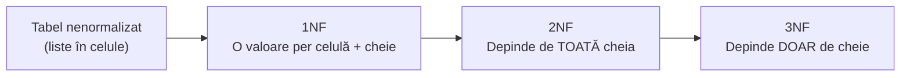
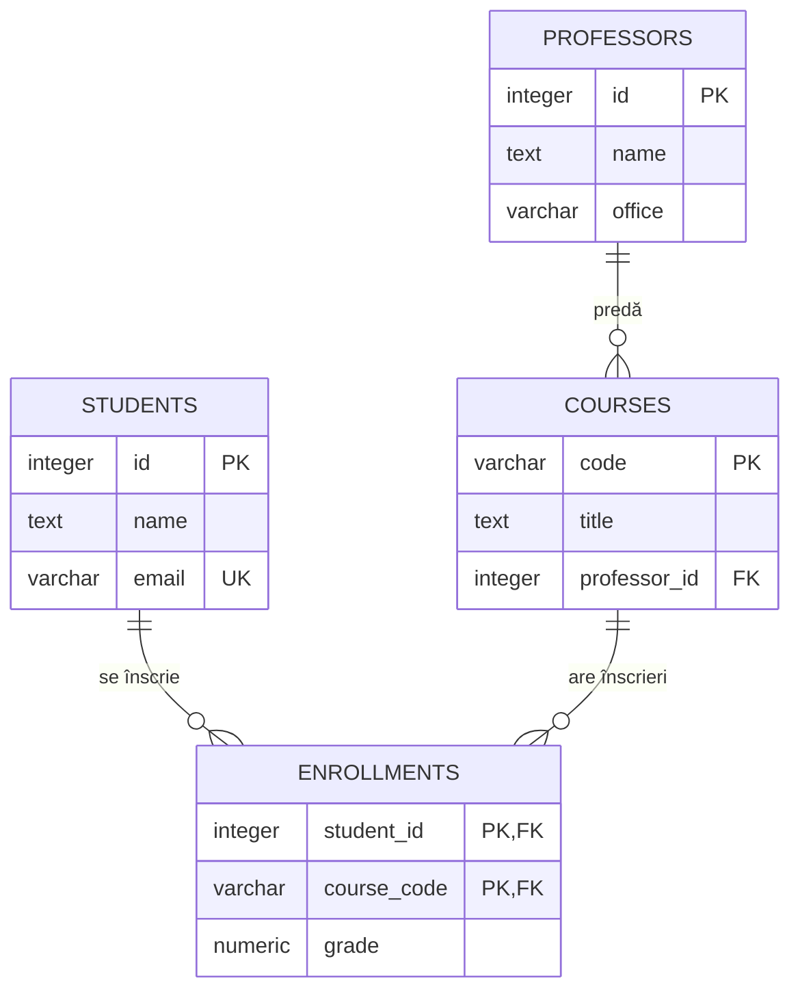

# Laboratorul 5

!!! abstract "Obiective"

    Să ne reamintim cum putem crea o bază de date și tabelele din ea. Să învățăm care sunt „anomaliile” care pot apărea într-o bază de date relațională proiectată prost. Să înțelegem cum funcționează procesul de normalizare a bazei de date și ce beneficii are.

## Proiectarea și crearea unei baze de date

Când creăm o nouă bază de date (de exemplu, pentru proiect), parcurgem în principiu doi pași:

1. **Proiectăm** baza de date (_database design_), analizând entitățile / informațiile pe care vrem să le reținem și legăturile dintre ele, pentru a construi un „model mental” al datelor. În urma acestui proces de **proiectare**, putem fie să notăm în scris modelul dezvoltat (folosind **diagrame entitate-relație** și descrieri textuale) sau să trecem direct la faza de implementare.

2. **Creăm** baza de date (_database creation_) plecând de la modelul proiectat anterior, folosind comenzi de [**Data Definition Language**](https://www.postgresql.org/docs/current/ddl.html) (DDL). Putem salva fișierul SQL cu comenzile de creare pentru backup sau pentru a putea migra în viitor baza de date către un alt sistem.

Ulterior finalizării pasului 2, putem începe să folosim schema nou-creată, introducând date în aceasta, efectuând interogări, modificări etc.

Dacă în trecut se obișnuia să se realizeze complet pasul de proiectare înainte de a începe implementarea ([_waterfall model_](https://en.wikipedia.org/wiki/Waterfall_model)), metodologiile de dezvoltare „[_agile_](https://en.wikipedia.org/wiki/Agile_software_development)” din prezent susțin o abordare iterativă, în care se proiectează și implementează mai întâi o parte mai mică din modelul final, revenind ulterior pe el și adăugând noi tabele și relații până se ajunge la produsul final. Avantajul cu această a doua variantă este că reduce efortul de analiză și risipa de timp, deoarece creăm tabelele și le legăm între ele pe măsură ce realizăm că avem nevoie de ele.

## Unelte pentru proiectarea bazelor de date

Pentru proiectarea vizuală a unei scheme de bază de date relațională, există o multitudine de unelte online sau descărcabile:

- [dbdiagram.io](https://dbdiagram.io/)
- [dbdesign.io](https://dbdesign.io/)
- [drawDB](https://www.drawdb.app/)
- [drawSQL](https://drawsql.app/)
- [DBeaver](https://dbeaver.io/)

Majoritatea sunt aplicații proprietare, dar oferă variante gratuite (cu limitări) care ar trebui să fie suficiente pentru nevoile noastre la această materie. Unele dintre ele au suport și pentru o reprezentare textuală a schemei, sau chiar exportarea comenzilor DDL necesare creării bazei de date într-un sistem relațional.

## Recapitulare comenzi DDL

Am menționat aceste comenzi și în laboratorul 2, când încercam să vedem cum funcționează script-ul de creare a bazei de date demo. Acum le vom revizui și vom încerca să le înțelegem în profunzime.

### Ierarhia obiectelor dintr-o bază de date PostgreSQL

Dacă ați lucrat cu [DataGrip](https://www.jetbrains.com/datagrip/) până acum, probabil că ați observat în interfață o ierarhie plecând de la „sursa de date” (conexiunea la baza de date) pe care ați adăugat-o inițial în primul laborator:

<figure markdown="span">

<figcaption>Ierarhia bazei de date în DataGrip</figcaption>
</figure>

#### Sursele de date

O **sursă de date** (un [_data source_](https://www.jetbrains.com/help/datagrip/managing-data-sources.html)) reprezintă o configurație de conexiune la un sistem de gestiune a bazelor de date. În cazul nostru, ne conectăm la o instanță a server-ului [PostgreSQL](https://www.postgresql.org/) care rulează containerizat sau direct pe calculatorul nostru.

#### Bazele de date

În cadrul acestei instanțe de PostgreSQL, putem avea una sau mai multe **baze de date** (_databases_), identificate prin denumirile lor (în exemplul de mai sus: `exercitiu`, `lab3`, `postgres` etc.). Pe acestea le putem gestiona folosind comenzi precum `CREATE DATABASE` sau `DROP DATABASE`.

Motivul pentru care ne dorim să avem mai multe baze de date diferite pe același server este pentru a permite mai multor aplicații și mai multor utilizatori să folosească aceeași infrastructură (aceeași instanță de PostgreSQL, aceeași stocare etc). Putem aloca diferiților utilizatori permisiuni și restricții referitoare la fiecare bază de date în parte.

Fiecare bază de date conține una sau mai multe [**scheme**](https://www.postgresql.org/docs/current/ddl-schemas.html), care sunt ca niște „foldere” pentru tabelele bazei de date. Putem avea două tabele cu același nume în aceeași bază de date, presupunând că sunt în scheme diferite. Pentru a ne referi neambiguu la un tabel, putem folosi sintaxa `nume_schemă.nume_tabel`. De exemplu, `SELECT coloana1, coloana2 FROM schema1.tabel1`.

Când creăm o nouă bază de date, Postgres creează o schemă implicită denumită `public`. Dacă nu menționăm vreo altă scheme pentru tabelele noastre, ne vom referi implicit la cele din această schemă.

#### Obiectele globale la nivel de server

Observați și folder-ul cu _Server Objects_, reprezentând înregistrările „globale”, care afectează toate bazele de date din sistem:

- Un [**rol**](https://www.postgresql.org/docs/current/user-manag.html) (în terminologia PostgreSQL) reprezintă un **utilizator** sau un **grup de utilizatori**, cărora le putem da diferite **permisiuni** asupra unei baze de date, sau la nivel de scheme / tabele individuale.

- Unul sau mai multe [**spații de tabele**](https://www.postgresql.org/docs/current/manage-ag-tablespaces.html), care indică sistemului de gestiune cum și unde să stocheze datele pe disk.

#### Securizarea sistemului de baze de date

Nu vom intra în detalii referitor la gestiunea utilizatorilor și permisiunilor la acest curs (puteți citi mai multe în [documentația oficial PostgreSQL](https://www.postgresql.org/docs/18/user-manag.html)), dar [autentificarea și autorizarea](https://www.okta.com/identity-101/authentication-vs-authorization/) sunt mecanisme care stau la baza securității unui SGBD. Conform [principiului celui mai mic privilegiu](https://en.wikipedia.org/wiki/Principle_of_least_privilege), rolurile pe care le folosim ca să accesăm baza de date ar trebui să aibă un set minimal de permisiuni care să ne permită să ne desfășurăm activitatea.

De exemplu, deși acum folosim contul implicit de superuser (`postgres`) pentru a gestiona și interoga sistemul, am fi putut să creăm un cont cu permisiuni limitate la nivel de o singură bază de date sau cu acțiuni restricționate (de exemplu, care poate doar să citească date din tabele, nu să le modifice). Astfel de restricții sunt folosite în producție pentru a îmbunătăți securitatea, în caz că parola pentru un cont ajunge să fie furată.

### Comenzi de definire a schemei bazei de date

Pentru a crea și modifica structura unei baze de date în PostgreSQL, folosim următoarele comenzi DDL:

#### `CREATE DATABASE` și `CREATE SCHEMA`

Cu aceste comenzi, putem crea baze de date și scheme noi:

```sql
-- Creează o bază de date nouă
CREATE DATABASE universitate;

-- În psql ne conectăm cu: \connect universitate
-- În DataGrip, schimbăm din dreapta-sus baza de date curentă

-- Creează o schemă (un „folder” logic) în baza de date curentă
-- Clauza de `IF NOT EXISTS` ne asigură că nu va da eroare dacă deja există acea schemă
CREATE SCHEMA IF NOT EXISTS academic;
```

După crearea schemei, putem crea și accesa tabele în ea prefixându-le cu numele schemei (de ex. `academic.professors`), spre deosebire de schema implicită `public`.

#### `CREATE TABLE`

Definește un tabel nou, precizând coloanele, tipurile de date și constrângerile de integritate:

```sql
CREATE TABLE IF NOT EXISTS academic.professors (
    id SERIAL PRIMARY KEY,
    name TEXT NOT NULL,
    email VARCHAR(120) UNIQUE NOT NULL,
    office VARCHAR(32)
);

CREATE TABLE IF NOT EXISTS academic.courses (
    code VARCHAR(16) PRIMARY KEY,
    title TEXT NOT NULL,
    credits INTEGER NOT NULL CHECK (credits BETWEEN 1 AND 30),
    professor_id INTEGER NOT NULL REFERENCES academic.professors(id) ON DELETE RESTRICT,
    is_active BOOLEAN NOT NULL DEFAULT TRUE
);
```

La definirea unei chei străine (`REFERENCES ...`), putem controla ce se întâmplă când un rând „părinte” este șters:

- **`ON DELETE RESTRICT`** (comportament implicit, similar cu `NO ACTION`): blochează ștergerea unui profesor atât timp cât există cursuri care depind de el;
- **`ON DELETE CASCADE`**: șterge automat și rândurile „copil” dependente (util pentru tabele asociative sau măsurători);
- **`ON DELETE SET NULL`**: pune `NULL` în cheia străină a rândurilor dependente (dacă acea coloană permite `NULL`).

Dacă cheia primară este **compusă** (formată din mai multe coloane), o declarăm la finalul definiției tabelului:

```sql
CREATE TABLE IF NOT EXISTS academic.enrollments (
    student_id INTEGER NOT NULL,
    course_code VARCHAR(16) NOT NULL REFERENCES academic.courses(code) ON DELETE CASCADE,
    grade NUMERIC(4, 2) CHECK (grade BETWEEN 1.00 AND 10.00),
    PRIMARY KEY (student_id, course_code)
);
```

#### `ALTER TABLE`

Modifică structura unui tabel existent fără a-i șterge datele (dacă noile reguli sunt compatibile cu datele deja salvate):

```sql
ALTER TABLE academic.professors
    ADD COLUMN department TEXT NOT NULL DEFAULT 'Fizică';

ALTER TABLE academic.professors
    ALTER COLUMN office SET NOT NULL;

ALTER TABLE academic.courses
    DROP COLUMN is_active;
```

!!! warning "Atenție la `DROP COLUMN`"

    `ALTER TABLE ... DROP COLUMN` șterge definitiv coloana și toate datele din ea. Verificați întotdeauna impactul (și faceți un backup) înainte de a elimina coloane.

#### `DROP DATABASE`, `DROP SCHEMA`, `DROP TABLE`

Elimină permanent obiecte din baza de date:

```sql
DROP TABLE IF EXISTS academic.enrollments;
DROP SCHEMA IF EXISTS academic CASCADE;
DROP DATABASE IF EXISTS universitate; -- trebuie să fim conectați la altă bază (ex. postgres)
```

Implicit, `DROP TABLE` și `DROP SCHEMA` refuză ștergerea dacă există alte obiecte dependente (`RESTRICT`). Adăugarea lui `CASCADE` șterge automat și obiectele sau constrângerile care depind de ele.

## Principii și bune practici pentru proiectarea unei baze de date

Câteva sfaturi pentru proiectele voastre:

- **Un tabel = o singură entitate sau relație**: nu amestecați în același tabel informații despre lucruri diferite (de ex. studenți, cursuri și profesori). Relațiile **1-la-N** se leagă printr-o cheie străină în tabelul „N”, iar relațiile **M-la-N** printr-un tabel intermediar.
- **Chei primare surogat vs. naturale**: o **cheie naturală** (ex. `email`, `course_code`) are sens în domeniul problemei, dar se poate schimba în timp; o **cheie surogat** (`id SERIAL PRIMARY KEY`) nu se schimbă niciodată și simplifică legăturile dintre tabele (păstrând `UNIQUE` pe coloanele naturale precum `email`).
- **Tipuri de date și denumiri consecvente**: folosiți `snake_case` cu litere mici și alegeți tipuri exacte (`NUMERIC` în loc de `FLOAT` pentru note sau bani, `TIMESTAMPTZ` pentru momente de timp, `DATE` pentru date calendaristice).
- **Validare direct în baza de date**: folosiți `NOT NULL`, `UNIQUE`, `CHECK` și `FOREIGN KEY` astfel încât nicio comandă să nu poată introduce date invalide.

Nu vă temeți să experimentați și să greșiți. Primele câteva baze de date pe care le veți proiecta și implementa singuri nu vor ieși atât de bine pe cât v-ați dori, dar cu experiența acumulată veți știi la ce să aveți grijă în viitor.

## Anomaliile care pot apărea

Să presupunem că punem toate informațiile despre studenți, cursuri, profesori și note într-un singur tabel `student_enrollments`, cu cheia primară compusă `(student_id, course_code)`:

| `student_id` | `student_name` | `student_email` | `course_code` | `course_title` | `professor_id` | `professor_name` | `professor_office` | `grade` |
| :-: | - | - | :-: | - | :-: | - | - | :-: |
| `101` | Ana Popescu | `ana@s.unibuc.ro` | `BD-201` | Baze de date | `1` | Gabriel Majeri | 101 | `9.50` |
| `101` | Ana Popescu | `ana@s.unibuc.ro` | `ROB-105` | Sisteme embedded | `2` | Petre Boboc | 102 | `8.75` |
| `102` | Mihai Cutărescu | `mihai@s.unibuc.ro` | `BD-201` | Baze de date | `1` | Gabriel Majeri | 101 | `9.00` |
| `103` | Exemplu Marinescu | `exemplu@s.unibuc.ro` | `ALG-101` | Algebră | `3` | Ion Exemplescu | 203 | `10.00` |

Observați **redundanța**: datele studentei Ana Popescu apar de două ori, iar detaliile cursului `BD-201` și ale profesorului său se repetă la fiecare student înscris. Această structură generează trei **anomalii**:

1. **Anomalia de inserare**: nu putem adăuga un curs nou (de ex. `AI-301`) dacă niciun student nu s-a înscris încă la el, deoarece `student_id` face parte din cheia primară și nu poate fi `NULL`. La fel, nu putem înregistra un student care nu participă încă la niciun curs.
2. **Anomalia de actualizare**: dacă `Gabriel Majeri` își schimbă biroul în `103`, trebuie să modificăm toate rândurile în care apare. Dacă uităm unul, baza de date devine **inconsistentă** (același profesor cu două birouri diferite).
3. **Anomalia de ștergere**: dacă `Exemplu Marinescu` se retrage de la `ALG-101` și îi ștergem rândul, pierdem complet și informațiile despre cursul `Algebră` și despre profesorul `Ion Exemplescu`!

## Formele de normalizare

**Normalizarea** este procesul prin care împărțim un tabel mare și redundant în tabele mai mici, legate prin chei străine, astfel încât fiecare informație să fie stocată **într-un singur loc**.

Pentru a înțelege ușor primele trei forme normale, rețineți această regulă intuitivă:

!!! Regulă

    Orice coloană dintr-un tabel trebuie să descrie **cheia** (1NF), **toată** cheia (2NF) și **doar** cheia (3NF).

Spunem că o coloană $A$ **determină** o coloană $B$ (notat $A \to B$, numit *dependență funcțională*) dacă, știind valoarea lui $A$, știm exact o singură valoare pentru $B$ — de exemplu, `student_id` $\to$ `student_name`.



### 1NF: O singură valoare per celulă

Un tabel este în **prima formă normală (1NF)** dacă:

- fiecare celulă conține o **singură valoare** (fără liste separate prin virgulă precum `'BD-201, ROB-105'`);
- nu există **coloane repetitive** (de ex. `curs_1`, `curs_2`, `curs_3`);
- există o **cheie primară** care identifică unic fiecare rând.

De exemplu, dacă inițial am fi avut:

| `student_id` | `student_name` | `courses` |
| :-: | - | - |
| `101` | Ana Popescu | `BD-201, ROB-105` |
| `102` | Mihai Ionescu | `BD-201` |

Pentru a trece în **1NF**, punem fiecare curs pe un rând separat și folosim cheia primară `(student_id, course_code)`. Tabelul `student_enrollments` din secțiunea de anomalii este deja în 1NF — dar am văzut că **1NF nu este suficientă** pentru a elimina redundanța.

### 2NF: Fiecare coloană depinde de *toată* cheia

Un tabel este în **a doua formă normală (2NF)** dacă este în 1NF și nicio coloană nu depinde doar de **o bucată** din cheia primară compusă.

!!! tip "Scurtătură practică"

    Dacă un tabel este în 1NF și cheia lui primară este formată dintr-o **singură coloană** (ex. `id`), el este **automat în 2NF**.

În `student_enrollments`, cheia primară este compusă: `(student_id, course_code)`. Însă:

- `student_name` și `student_email` depind **doar de `student_id`** (nu au legătură cu cursul);
- `course_title`, `professor_id`, `professor_name` și `professor_office` depind **doar de `course_code`** (nu au legătură cu studentul);
- doar `grade` depinde de **ambele** (`student_id` și `course_code`).

Soluția pentru **2NF** este să mutăm aceste coloane în propriile tabele:

- `students(student_id PK, student_name, student_email)`
- `courses(course_code PK, course_title, professor_id, professor_name, professor_office)`
- `enrollments(student_id PK/FK, course_code PK/FK, grade)`

Acum putem adăuga sau șterge un student, un curs ori o înscriere fără să afectăm celelalte entități!

### 3NF: Fiecare coloană depinde *doar* de cheie (nu și între ele)

Un tabel este în **a treia formă normală (3NF)** dacă este în 2NF și nu are coloane non-cheie care depind de **alte coloane non-cheie** (dependențe „în lanț” / *tranzitive*).

Priviți tabelul `courses` obținut la pasul 2NF:

```text
course_code (PK) -> professor_id -> professor_name, professor_office
```

`professor_name` și `professor_office` nu descriu cursul, ci profesorul! Dacă un profesor predă mai multe cursuri și își schimbă biroul, informația lui tot se repetă. Pentru a ajunge la **3NF**, separăm profesorii în propriul tabel `professors`, legat prin `professor_id`:



Codul de DDL corespunzător ar fi:

```sql
CREATE TABLE students (
    id SERIAL PRIMARY KEY,
    name TEXT NOT NULL,
    email VARCHAR(120) UNIQUE NOT NULL
);

CREATE TABLE professors (
    id SERIAL PRIMARY KEY,
    name TEXT NOT NULL,
    office VARCHAR(32) NOT NULL
);

CREATE TABLE courses (
    code VARCHAR(16) PRIMARY KEY,
    title TEXT NOT NULL,
    professor_id INTEGER NOT NULL REFERENCES professors(id) ON DELETE RESTRICT
);

CREATE TABLE enrollments (
    student_id INTEGER NOT NULL REFERENCES students(id) ON DELETE CASCADE,
    course_code VARCHAR(16) NOT NULL REFERENCES courses(code) ON DELETE CASCADE,
    grade NUMERIC(4, 2) CHECK (grade BETWEEN 1.00 AND 10.00),
    PRIMARY KEY (student_id, course_code)
);
```

### Pe scurt: BCNF și compromisul cu denormalizarea

- **BCNF (*Boyce-Codd Normal Form*)** este o formă puțin mai strictă decât 3NF: *orice coloană (sau grup de coloane) care determină alte coloane trebuie să fie o cheie a tabelului*. În practică, 3NF și BCNF coincid în aproape toate cazurile obișnuite (diferă doar în situații rare cu mai multe chei candidate compuse care se suprapun).
- **Normalizare vs. denormalizare**: normalizarea elimină redundanța și anomaliile de scriere, fiind ideală pentru aplicații tranzacționale (**OLTP**). Totuși, o schemă împărțită în foarte multe tabele poate necesita multe `JOIN`-uri la citire; în sistemele de analiză (**OLAP**) se mai reintroduce controlat redundanța (*denormalizare*), dar regula practică rămâne: **proiectați mai întâi curat până la 3NF, și denormalizați doar dacă măsurătorile arată o problemă reală de performanță**.

## Exerciții

Pentru exerciții, vom porni de la un tabel **denormalizat** cu împrumuturi de echipamente din laboratoarele de robotică și electronică: [`robotics_lab_denormalized.sql`](data/robotics_lab_denormalized.sql).

1. Creați o bază de date nouă (`lab5`), importați fișierul [`robotics_lab_denormalized.sql`](data/robotics_lab_denormalized.sql) și inspectați datele cu `SELECT * FROM lab_reservations_raw;`.

2. Identificați în `lab_reservations_raw`:
    - două exemple de date redundante;
    - câte un exemplu concret de **anomalie de inserare**, **actualizare** și **ștergere** (de ex. ce dispare dacă ștergem rezervarea `'RES-005'`?);
    - ce încalcă **1NF**, **2NF** și **3NF** (observați coloana `team_members` și legătura `coordinator_name -> coordinator_email`).

3. Desenați diagrama ER (în [dbdiagram.io](https://dbdiagram.io/), [drawDB](https://www.drawdb.app/) sau pe hârtie) pentru schema normalizată în **3NF**, definind entități separate pentru: `coordinators`, `teams`, `students`, `equipment`, `reservations` și `reservation_items`.

4. În baza de date `lab5`, creați o schemă separată folosind `CREATE SCHEMA normalized;`, activați-o și executați comenzile `CREATE TABLE` pentru cele 6 tabele proiectate la exercițiul 3, incluzând constrângeri potrivite (`PRIMARY KEY`, `FOREIGN KEY` cu `ON DELETE ...`, `NOT NULL`, `UNIQUE`, și un `CHECK` pentru `returned_at IS NULL OR returned_at >= borrowed_at`).

5. **Migrarea datelor**: populați tabelele din `normalized` folosind interogări `INSERT INTO normalized.tabel (...) SELECT DISTINCT ... FROM public.lab_reservations_raw ...`.

    !!! tip "Separarea coloanei `team_members` în PostgreSQL (pentru 1NF)"

        Puteți transforma lista `'Andrei Popa, Maria Stan'` în rânduri individuale folosind `STRING_TO_ARRAY`, `UNNEST` și `TRIM`:

        ```sql
        SELECT DISTINCT
            team_code,
            TRIM(UNNEST(STRING_TO_ARRAY(team_members, ','))) AS full_name
        FROM public.lab_reservations_raw;
        ```

6. Verificați migrarea în două moduri:
    - scrieți un `SELECT` cu `JOIN` peste schema `normalized` care să afișeze aceleași detalii despre rezervări ca tabelul inițial;
    - testați că anomaliile au dispărut: adăugați un echipament nou fără nicio rezervare, modificați email-ul unui coordonator într-un singur loc, și ștergeți rezervarea `'RES-005'` verificând că echipa `'TEAM-GAMMA'` și osciloscopul `'OSCILLO-02'` rămân în baza de date.
