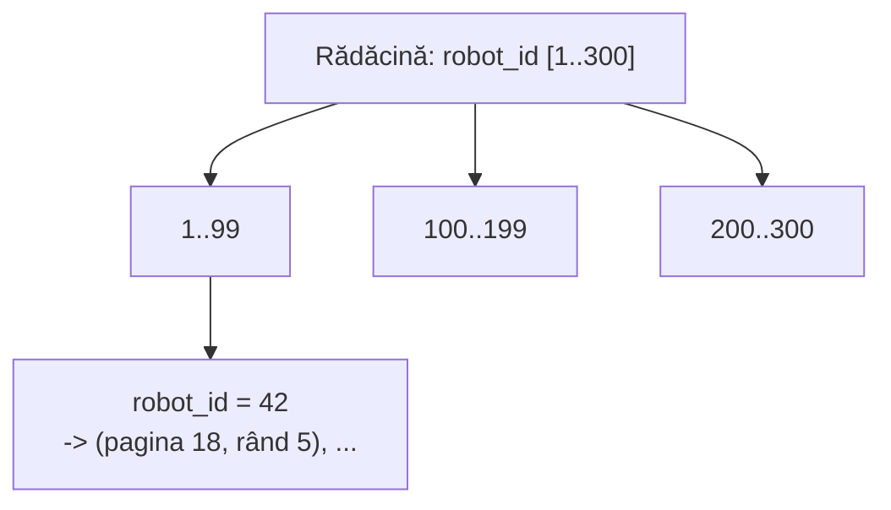

# Laboratorul 6

!!! abstract "Obiective"

    Să înțelegem cum o bază de date relațională găsește informațiile pe disk și de ce un index poate ajuta la îmbunătățirea performanței. Să vedem cum putem folosi indecșii de unicitate pentru a preveni înregistrările duplicate.

## Cum sunt stocate și citite datele pe disk

Când rulăm o interogare `SELECT ... WHERE ...`, sistemul de gestiune a bazelor de date trebuie să găsească rândurile potrivite pe disk (sau în cache-ul din memorie). Pentru a înțelege de ce unele interogări sunt lente, trebuie să vedem cum sunt organizate datele intern. Referința oficială este [această secțiune](https://www.postgresql.org/docs/current/storage.html) din documentația PostgreSQL.

### Pagini (*pages*) și *Sequential Scan*

PostgreSQL nu citește rânduri individuale de pe disk, ci blocuri de dimensiune fixă (implicit **8 KB**), numite **pagini** (*pages* sau *blocks*). O singură pagină conține de obicei zeci sau sute de rânduri.

Dacă nu există niciun index potrivit pentru condiția din `WHERE`, PostgreSQL efectuează o **scanare secvențială** (**`Sequential Scan`** / `Seq Scan`): citește **toate** paginile tabelului de la început până la sfârșit și verifică fiecare rând în parte.

- Pe un tabel cu 100 de rânduri, un `Seq Scan` durează o fracțiune de milisecundă.
- Pe un tabel cu 500.000 sau 10 milioane de rânduri (care ocupă zeci de MiB sau GiB pe disk), citirea întregului tabel pentru a găsi doar câteva rânduri devine foarte lentă.

### Ce este un index și cum funcționează B-tree

Un **index** este o structură de date separată, menținută automat de SGBD, care funcționează exact ca **indexul de la sfârșitul unei cărți**: în loc să răsfoim toate cele 500 de pagini ale cărții ca să găsim termenul „B-tree”, căutăm rapid termenul în indexul ordonat alfabetic și mergem direct la pagina indicată.

În PostgreSQL, tipul de index implicit este [**B-tree**](https://www.postgresql.org/docs/current/indexes-types.html) (*balanced tree*), un [arbore de căutare echilibrat](https://web.stanford.edu/class/archive/cs/cs166/cs166.1146/lectures/02/Small02.pdf) în care valorile coloanei indexate sunt păstrate sortate:



Când căutăm `WHERE robot_id = 42`, PostgreSQL coboară câteva niveluri în arbore în timp logaritmic $O(\log n)$ și obține adresele exacte (numărul paginii și poziția din pagină) ale rândurilor căutate (**`Index Scan`** sau **`Bitmap Heap Scan`**), fără să citească restul tabelului.

Sintaxa de bază pentru crearea și ștergerea unui index este:

```sql
-- Crearea unui index B-tree pe coloana `robot_id` a tabelului `telemetry_logs`
CREATE INDEX idx_telemetry_robot_id ON telemetry_logs (robot_id);

-- Ștergerea unui index
DROP INDEX IF EXISTS idx_telemetry_robot_id;
```

## Analiza performanței: `EXPLAIN` și `EXPLAIN ANALYZE`

Pentru a nu ghici dacă o interogare folosește sau nu un index, PostgreSQL ne pune la dispoziție comanda [`EXPLAIN`](https://www.postgresql.org/docs/current/sql-explain.html):

- **`EXPLAIN <interogare>`**: afișează **planul estimat** de execuție și costul calculat de *query planner*, **fără a executa** interogarea (util pentru interogări foarte lente sau pentru `DELETE`/`UPDATE`).
- **`EXPLAIN ANALYZE <interogare>`**: **execută efectiv** interogarea și afișează atât estimările, cât și valorile reale măsurate (`actual time`, `rows`, `Execution Time`). Adăugând opțiunea `(ANALYZE, BUFFERS)`, vedem și câte pagini de 8 KB au fost citite din memorie (`hit`) sau de pe disk (`read`).

!!! warning "Atenție"

    Deoarece `EXPLAIN ANALYZE` execută comanda, rularea acestei analize pe o comandă de tip `INSERT`, `UPDATE` sau `DELETE` va modifica efectiv datele din tabel!

### Exemplu concret: înainte și după index

Pe un tabel `telemetry_logs` cu `500.000` de rânduri (~`6.945` pagini, ~`54 MB`), vrem să găsim măsurătorile recente ale robotului `42`:

```sql
EXPLAIN (ANALYZE, BUFFERS)
SELECT id, sensor_type, recorded_at, value
FROM telemetry_logs
WHERE robot_id = 42
  AND recorded_at >= TIMESTAMPTZ '2026-10-25 00:00:00+03';
```

**Înainte de index**, PostgreSQL citește toate cele `6.945` de pagini ale tabelului printr-un `Parallel Seq Scan` (~`24 ms` din memorie, sau sute de ms de pe disk):

```text
Gather  (cost=1000.00..11112.90 rows=429 width=29) (actual time=17.111..23.916 rows=426.00 loops=1)
  ...
  -> Parallel Seq Scan on telemetry_logs  (cost=0.00..10070.00 rows=179 width=29) ...
       Filter: ((recorded_at >= ...) AND (robot_id = 42))
       Rows Removed by Filter: 166525
       Buffers: shared hit=6945
Execution Time: 23.962 ms
```

După ce creăm un index potrivit pe `(robot_id, recorded_at)`, aceeași interogare găsește exact cele `426` de rânduri în mai puțin de **1 ms**, citind doar paginile necesare:

```text
Bitmap Heap Scan on telemetry_logs  (cost=12.72..1351.42 rows=419 width=29) (actual time=0.159..0.614 rows=426.00 loops=1)
  Recheck Cond: ((robot_id = 42) AND (recorded_at >= ...))
  Buffers: shared hit=426 read=5
  -> Bitmap Index Scan on idx_telemetry_robot_time  (cost=0.00..12.61 rows=419 width=0) ...
Execution Time: 0.653 ms
```

### *Query planner*, statistici și selectivitate

Componenta numită [**query planner/optimizer**](https://www.postgresql.org/docs/current/planner-optimizer.html) decide automat **cum** să execute fiecare interogare (de ex. `Seq Scan` vs. `Index Scan`). Pentru a estima câte rânduri va întoarce o condiție `WHERE`, planner-ul consultă statistici interne despre distribuția valorilor din tabele (actualizate periodic de procesul de _autovacuum_ sau manual prin comanda `ANALYZE nume_tabel;`).

Două concepte influențează decisiv utilitatea unui index:

- **Cardinalitatea** (*cardinality*): numărul de valori distincte dintr-o coloană (ex. `id` are cardinalitate maximă; o coloană booleană are cardinalitate `2`).
- **Selectivitatea** (*selectivity*): proporția de rânduri din tabel selectate de o condiție. Un index ajută atunci când condiția este **foarte selectivă** (întoarce un procent mic din rânduri, ex. 1%).

De exemplu, dacă în `telemetry_logs` ~95% din rânduri au `status = 'ok'` și doar 1% au `status = 'error'`, un index pe `status`:

- va fi **ignorat** de planner pentru `WHERE status = 'ok'` (citirea aleatorie prin index a 95% din tabel este mai lentă decât un `Seq Scan` liniar!);
- va fi **folosit** cu succes pentru `WHERE status = 'error'`.

## Tipuri utile de indecși

### Indecși compuși și ordinea coloanelor

Putem indexa mai multe coloane împreună, obținând un așa-zis [**index compus**](https://www.postgresql.org/docs/current/indexes-multicolumn.html) (_composite index_):

```sql
CREATE INDEX idx_telemetry_robot_time
    ON telemetry_logs (robot_id, recorded_at);
```

Gândiți-vă la un index compus `(A, B)` ca la o carte de telefon sortată mai întâi după `Nume (A)` și apoi după `Prenume (B)`:

- Funcționează excelent pentru `WHERE robot_id = 42` sau `WHERE robot_id = 42 AND recorded_at >= ...` (**egalitate pe prima coloană**, eventual urmată de un interval pe a doua).
- Dacă filtrăm **doar** după a doua coloană (`WHERE recorded_at >= ...`, fără `robot_id`), prima coloană nu mai restrânge căutarea dintr-o singură lovitură (planner-ul va recurge fie la `Seq Scan` pe intervale mari, fie la scanări repetate pe fiecare valoare distinctă a lui `robot_id`).

!!! tip "Cum alegem ordinea coloanelor?"

    Puneți pe prima poziție coloanele testate prin **egalitate (`=`)** sau cu **selectivitate mai mare**, iar la final coloanele testate prin **intervale (`>`, `<`, `BETWEEN`)**.

### Indecși parțiali (*Partial indexes*)

Dacă interogăm frecvent doar un subset mic și bine definit de rânduri (de ex. doar pachetele cu erori `status = 'error'`, care reprezintă 1% din tabel), nu are rost să indexăm și celelalte 99% de rânduri! Putem crea un **index parțial** adăugând o clauză `WHERE`:

```sql
CREATE INDEX idx_telemetry_errors
    ON telemetry_logs (recorded_at)
    WHERE status = 'error';
```

În exemplul nostru, indexul compus pe tot tabelul ocupă **15 MB**, pe când indexul parțial ocupă doar **128 kB** și este mult mai rapid de întreținut la inserări!

### Indecși de unicitate (*Unique indexes*)

Un [**index de unicitate**](https://www.postgresql.org/docs/current/indexes-unique.html) împiedică inserarea valorilor duplicate și în același timp accelerează căutările:

```sql
CREATE UNIQUE INDEX idx_operators_email_lower
    ON operators (LOWER(email));
```

Deși constrângerea `UNIQUE` din `CREATE TABLE` creează automat în spate un index de unicitate simplu, comanda `CREATE UNIQUE INDEX` ne permite lucruri imposibile cu un simplu `UNIQUE` pe coloană:

- **Unicitate pe expresii** (ex. `LOWER(email)` — previne înregistrarea simultană a lui `'Ana@unibuc.ro'` și `'ana@unibuc.ro'`);
- **Unicitate parțială** (ex. `CREATE UNIQUE INDEX ... ON operators (email) WHERE is_active = TRUE;` — permite păstrarea în istoric a conturilor inactive cu același email, garantând unicitatea doar pentru conturile active).

## Costul indexării datelor

La fel ca orice lucru bun în viață, indecșii nu sunt „gratuiți”. Aceștia ne permită să **citim** datele mult mai rapid (inclusiv când vrem să facem un `UPDATE` / `DELETE` cu un filtru `WHERE`), dar încetinesc **scrierea**, deoarece la fiecare `INSERT`, `UPDATE` sau `DELETE`, PostgreSQL trebuie să actualizeze **atât tabelul**, cât și **toți indecșii afectați**. Totodată, ocupăm **spațiu suplimentar** pe disk pentru stocarea fiecărui index și avem nevoie de mai multă **memorie RAM** (pentru cache).

De aceea, nu se recomandă să adăugați indecși pe toate coloanele fără motiv. Creați indecși pe cheile străine folosite în `JOIN`-uri și pe coloanele care apar frecvent în filtre selective (`WHERE`) sau ordonări (`ORDER BY`). Cheile primare și coloanele `UNIQUE` primesc automat un index de la PostgreSQL.

## Exerciții

Pentru exerciții vom folosi scriptul [`telemetry_perf.sql`](data/telemetry_perf.sql), care generează `500.000` de înregistrări de telemetrie în câteva secunde.

1. Creați o bază de date nouă (`lab6`) și importați fișierul [`telemetry_perf.sql`](data/telemetry_perf.sql). Verificați dimensiunea tabelului `telemetry_logs` și a indecșilor existenți cu interogarea:

    ```sql
    SELECT
        pg_size_pretty(pg_relation_size('telemetry_logs')) AS table_size,
        pg_size_pretty(pg_total_relation_size('telemetry_logs')) AS total_size;
    ```

2. Rulați `EXPLAIN (ANALYZE, BUFFERS)` pentru interogarea de mai jos (înainte de a adăuga vreun index nou). Notați tipul de scanare, numărul de pagini citite și `Execution Time`:

    ```sql
    SELECT id, sensor_type, recorded_at, value
    FROM telemetry_logs
    WHERE robot_id = 42
      AND recorded_at >= TIMESTAMPTZ '2026-10-25 00:00:00+03';
    ```

3. Creați indexul compus `idx_telemetry_robot_time` pe `(robot_id, recorded_at)`, rulați `ANALYZE telemetry_logs;` și re-executați comanda `EXPLAIN (ANALYZE, BUFFERS)` de la exercițiul 2. Comparați planul de execuție și timpul obținut. Testați apoi și o interogare care filtrează doar după `recorded_at >= TIMESTAMPTZ '2026-10-15 00:00:00+03'` și observați ce plan alege PostgreSQL.

4. **Test de selectivitate și index parțial**:
    - Creați un index simplu pe `status` (`idx_telemetry_status`), rulați `ANALYZE telemetry_logs;` și comparați `EXPLAIN ANALYZE` pentru `SELECT COUNT(*) FROM telemetry_logs WHERE status = 'ok';` vs. `SELECT id, robot_id, recorded_at FROM telemetry_logs WHERE status = 'error' LIMIT 50;`. De ce ignoră planner-ul indexul în primul caz?
    - Ștergeți `idx_telemetry_status`, creați un **index parțial** pe `(recorded_at)` doar pentru `WHERE status = 'error'` și comparați dimensiunea lui cu cea a indexului compus folosind `pg_size_pretty(pg_relation_size('nume_index'))`.

5. **Indecși de unicitate**:
    - Încercați să inserați în tabelul `operators` un operator nou cu adresa `'Andrei.Exemplu@s.unibuc.ro'` (cu majuscule diferite față de rândul existent).
    - Ștergeți duplicatul, creați un index de unicitate pe `LOWER(email)` (`idx_operators_email_lower`) și verificați că o nouă încercare de inserare a aceluiași email cu majuscule diferite este respinsă cu eroare de PostgreSQL.

6. **Impactul asupra scrierilor (opțional)**: măsurați cât durează inserarea a `50.000` de rânduri noi în `telemetry_logs` (folosind `generate_series(500001, 550000)`) **cu** indecșii secundari creați la exercițiile 3–4 versus **după** ștergerea lor cu `DROP INDEX`.
